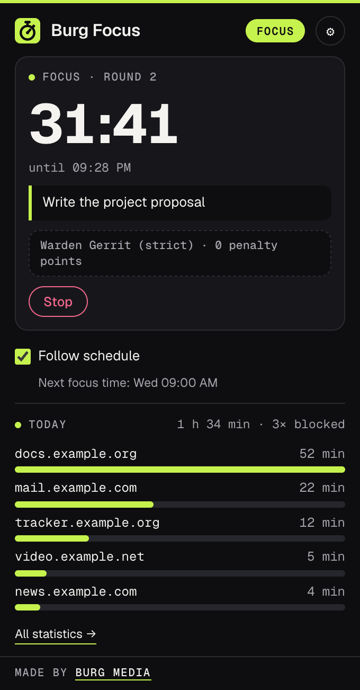
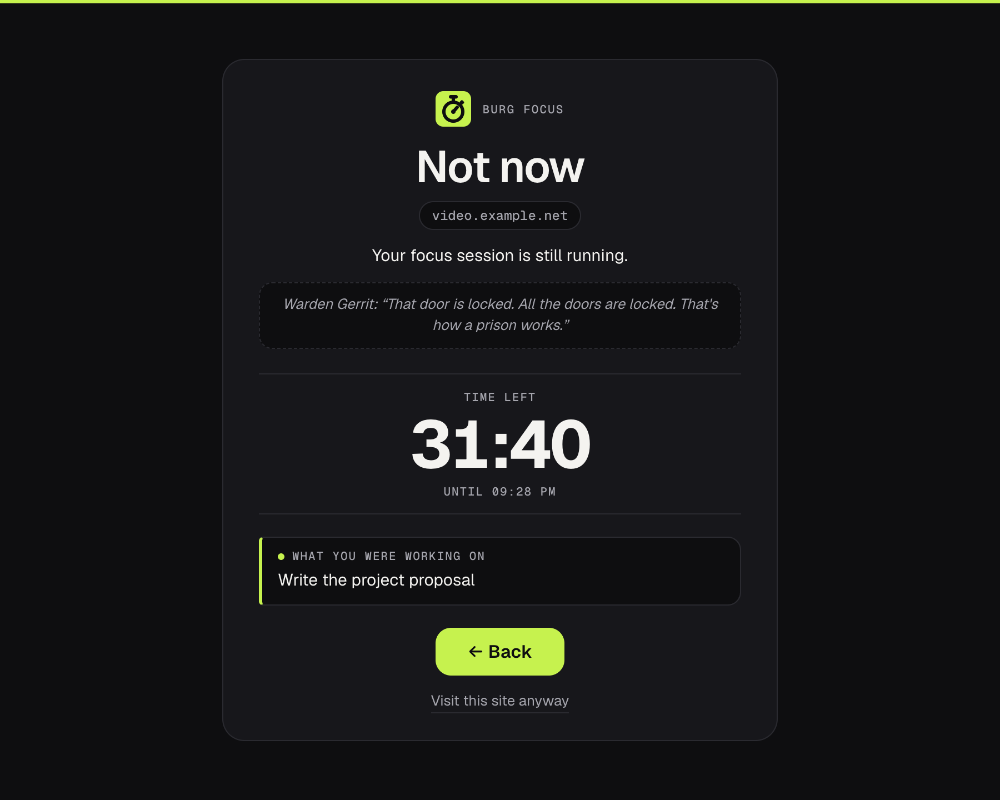
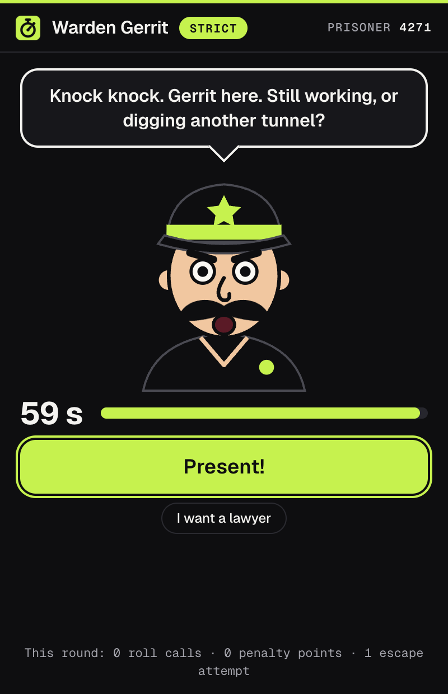

# Burg Focus

A Chrome extension that blocks distracting sites during focus sessions, on your own weekly schedule or once a site's daily time budget is used up, and shows where your browser time goes.





## Features

- **Focus sessions.** Rounds of 25, 50 or 90 minutes in Pomodoro style, with a short break (5 minutes) and a long break (15 minutes after every 4th round). All durations can be changed. You get a notification when a round or break ends, and you can start the next round from the notification, from the popup or automatically.
- **Weekly schedule.** Pick days and time slots in which distracting sites are closed automatically, for example weekdays 09:00 to 12:30 and 13:30 to 17:00.
- **Two modes.** Block the sites on your block list, or "only allow these sites" for deep work, where everything except your allowed sites is closed.
- **Domains or paths.** Block a whole domain including subdomains, or just part of it, such as `youtube.com/shorts`. Sites that change pages without a full reload are caught too.
- **Work domains.** Sites that are always allowed, in both modes. Local development hosts (`localhost`, `127.0.0.1`, `*.localhost`, `*.test`, `*.local`) are always allowed.
- **Time budget per site.** For example 20 minutes a day. Time only counts while the tab is in front and you are active at the computer (or the tab plays sound). When the budget is used up, the site stays closed until midnight, also outside focus time.
- **A hurdle before you give in.** Visiting a blocked site anyway, stopping a session or turning off the schedule during focus time costs a countdown (30 seconds by default) or retyping a sentence (pasting does not work). After that, the site is open for a few minutes (5 by default).
- **Lock.** Turn it on when you start a session and you can only stop or continue anyway once the round is over. While locked, the settings only let you add sites to the block list.
- **Calm block page** with the reason, a countdown and the note you were working on.
- **One-click block.** The popup shows the site in your current tab with a button to put it on the block list (or allow it in "only these sites" mode).
- **Statistics.** Time per day (chart) and per site, and how often a site was blocked, for today or the last 7, 30 or 90 days. Data older than 90 days is removed automatically, and you can clear it with one click.
- **Toolbar badge** with the minutes left in the current round or break, or `on` while your schedule is active.
- **Warden Gerrit (optional).** A prison guard who checks on you during the focus phase of a session, in three modes: *mild*, *strict* and *crazy*. He calls you in his own small window plus a notification when you sit still too long, when you hang around on a non-work site (if you have set work domains), or with random roll calls. Report in on time ("Present!", or in crazy mode by typing your prisoner number) or you get a penalty point; with penalty minutes turned on, each one makes the round 2 minutes longer. He notes every escape attempt on the block page and gives his verdict at the end of the round. His whistle is generated with Web Audio and can be turned off.
- **English and Dutch** interface, following your browser language.



## Install from source (Developer mode)

The easiest way to install Burg Focus is the Chrome Web Store version, linked from the [Burg Focus page](https://burgmedia.eu/shop/burg-focus). That version updates automatically. If you prefer to run the code from this repository, it takes a minute:

1. **Download the code.** Click the green **Code** button on this page and choose **Download ZIP**, or download the zip from [Releases](../../releases). Unzip it.
2. **Open the extensions page.** Type `chrome://extensions` in the address bar and press Enter.
3. **Turn on Developer mode.** Use the **Developer mode** switch in the top right corner.
4. **Load the extension.** Click **Load unpacked** and choose the unzipped folder (the folder that contains `manifest.json`).
5. **Pin it.** Click the puzzle piece icon in the toolbar and pin Burg Focus, so the icon is always visible.

Good to know:

- **Other browsers.** This also works in other Chromium based browsers, such as Microsoft Edge (`edge://extensions`), Brave (`brave://extensions`) and Opera (`opera://extensions`). The steps are the same; the Developer mode switch may be in a different place on the page. Burg Focus needs version 120 or newer.
- **No automatic updates.** An extension loaded this way does not update itself. To update, download the new version, replace the folder and click the **Reload** icon on the Burg Focus card in `chrome://extensions`.
- **Developer mode notice.** Chrome may remind you that extensions in developer mode are running. That is normal for extensions you load yourself.

## Check it yourself with your AI agent

The code is small, has no build step and is not minified, so you don't have to take our word for anything. Point your own AI agent (Claude Code, Cursor, Copilot, ChatGPT) at this folder and let it check.

```text
Audit this Chrome extension for security and privacy before I install it.
1. List every permission in manifest.json and whether the code actually needs it.
2. Find every network request (fetch, XMLHttpRequest, WebSocket, sendBeacon, image or
   script URLs, remote code) and tell me where data goes.
3. Check for remote code execution: eval, new Function, remotely loaded scripts.
4. Check what is stored (chrome.storage, IndexedDB, cookies) and whether anything
   leaves my browser.
5. Check content scripts: which sites they run on and what they read from pages.
6. Give a verdict: safe to install or not, with file and line references.
```

The fastest manual check, from inside the folder:

```sh
grep -rn "fetch\|XMLHttpRequest\|http" .
```

Besides this README you will find the burgmedia.eu links described below, the `http://*/*` and `https://*/*` match patterns in `manifest.json`, the SVG namespace (`http://www.w3.org/2000/svg`), an example URL in a comment and the URLs in the font license. There is no `fetch()` or other network request in the code.

## Privacy and security

- **No account, no analytics, no tracking, no ads.**
- **No remote code.** All JavaScript is in this repository. There are no CDNs or external scripts, and the extension pages only allow scripts from the extension itself (`script-src 'self'` in `manifest.json`). The fonts (Geist and Geist Mono) are included in `fonts/`.
- **No requests to servers.** The extension does not send data anywhere. There is no `fetch()`, `XMLHttpRequest`, `WebSocket` or `sendBeacon` in the code.
- **No content scripts.** Burg Focus never reads or changes the content of web pages. It only looks at tab addresses (URLs) to decide whether a site is blocked and which site the time counts for.
- **What it reads from your tabs.** The URL of the active tab in the focused window, on every tab switch, page change, window focus change and every 30 seconds; the URLs of all open tabs when the blocking rules change, so tabs that were already open are sent to the block page too; and whether a tab is playing sound. From the URL, only the domain name ends up in the statistics.
- **Idle detection.** `chrome.idle` tells the extension whether you have used the mouse or keyboard in the last 60 seconds (for Warden Gerrit: the last 90 seconds to 5 minutes, depending on the mode). This covers the whole computer, so working in another app counts as active. The idle state is only used in the moment and never stored.
- **Stored locally.** In `chrome.storage.local` on your device: your settings (lists, schedule, budgets, hurdle, notes you type), the running session, sites you opened temporarily, and per day the time spent per domain, how often each domain was blocked and Gerrit's roll calls and penalty points. Statistics are kept for 90 days. With Warden Gerrit on: a random four-digit prisoner number and the state of the current guarded round, including the domain of the non-work site you are on, if any. Nothing is synced.
- **Temporary session storage.** In `chrome.storage.session`, which Chrome empties when you close the browser: the tab being measured right now (domain, full URL, tab id and start time), the current focus state, a checksum of the blocking rules and the id of Gerrit's window.
- **You stay in control.** You can turn off time tracking per site in the settings (sites with a budget are still measured) and clear the statistics with one click. Removing the extension removes everything.
- **Not a prison.** Burg Focus makes distraction harder, it does not make it impossible: you can always turn it off in `chrome://extensions`, and it does not run in incognito windows unless you allow that.

What does go out, and when:

- **After installing**, a welcome page opens once on burgmedia.eu (`https://burgmedia.eu/extensies/burg-focus/welkom/`). **After removing** the extension, Chrome opens a short page there (`…/verwijderd/`). Both URLs carry only fixed labels (`utm_source=burg-focus&utm_medium=extension&utm_campaign=install` or `uninstall`). No settings, statistics, identifiers or browsing data are added. It is a normal page visit, so burgmedia.eu sees what any website sees, such as your IP address and browser; the privacy policy of burgmedia.eu applies there.
- **"Made by Burg Media"** at the bottom of the popup is a link with the same kind of labels (`utm_campaign=popup`). It opens only when you click it.

Found a security problem? See [SECURITY.md](SECURITY.md).

## Why is this free?

Burg Media is a small web studio in the Netherlands. We build these tools for our own work and give them away: no ads, no premium tier, no data collection. If they are useful to you, that is the best introduction to what we do. We build websites, web apps and custom software: [burgmedia.eu](https://burgmedia.eu)

## Permissions explained

| Permission | Why Burg Focus needs it |
|---|---|
| `declarativeNetRequest` | Blocking. While focus is on (a session or your schedule) or a site's budget is used up, the extension sets dynamic rules, built only from your own lists, that redirect page loads (`main_frame` only) of blocked sites to its own block page, with the original address after the `#`. Allow rules with a higher priority keep work domains, local development hosts and temporarily opened sites reachable. Chrome applies the rules itself; the extension does not see your other requests. |
| `tabs` | Reads tab URLs: the active tab, to measure time per site and to show the current site in the popup; all open tabs when the rules change, to send already open blocked tabs to the block page; and address changes without a page load (such as short video feeds), which `declarativeNetRequest` does not see. No page content is read. |
| `idle` | Checks whether you are active at the computer, so time only counts for budgets and statistics while you are there, and so Warden Gerrit can call you when you sit still too long. Not stored. |
| `alarms` | Timers for the end of a round or break, schedule boundaries, the end of a temporary exception, the midnight budget reset, Gerrit's deadlines and roll calls, and a tick every 30 seconds that updates measured time and the badge. |
| `notifications` | Tells you when a round or break is over (with a button to start the next round), shows Gerrit's calls and penalty points, and his verdict at the end of a round. |
| `storage` | Saves your settings, session, statistics and Gerrit's state locally on your device (`chrome.storage.local`), plus temporary working data in `chrome.storage.session`. |
| Host permissions `http://*/*`, `https://*/*` | Chrome only lets `declarativeNetRequest` redirect a page load to the block page for sites the extension has host access to. Because you choose which sites to block, this has to cover all http and https sites. There are no content scripts, so this access is not used to read or change pages. |

`web_accessible_resources` lists `blocked/blocked.html` so a blocked page load from a website can be redirected to it; this is not a permission. Burg Focus also uses `chrome.windows` (no permission needed) to open Gerrit's small window, and the Web Audio API for his whistle.

## Alternatives

Looking for an alternative to StayFocusd, BlockSite or LeechBlock? Burg Focus covers the same everyday need, closing the sites that eat your time when you want to work, with focus rounds, a weekly schedule, daily time budgets per site and statistics in one extension. Everything stays in your browser, there is no account or subscription, and the source is right here for you to read. And if a plain blocker is too easy to talk your way past, Warden Gerrit will keep an eye on you.

## License

[MIT](LICENSE), Copyright (c) 2026 Burg Media. Third-party components and their licenses are listed in [NOTICE.md](NOTICE.md).

Made by [Burg Media](https://burgmedia.eu).
